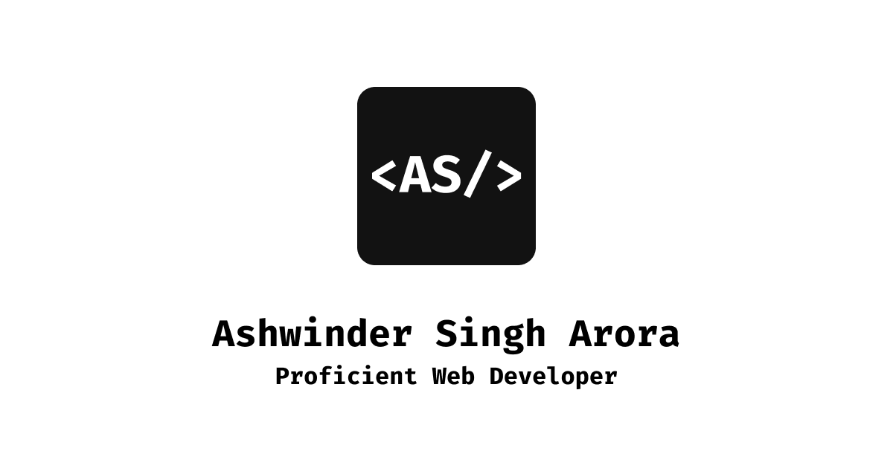

# Ashwinder Singh Arora — Portfolio

Live: **https://ashwinder.me**

Full-stack web developer (WordPress, PHP, JavaScript, REST APIs).
Single-page static portfolio. No framework, no bundler.

## Stack

- Semantic HTML in `index.html` (inline SVG sprite, no icon CDN)
- SCSS → `src/css/style.css` (partial Bootstrap 5.3: functions, variables,
  mixins, reboot, type, grid, buttons, helpers, utilities)
- Contact form via Web3Forms + hCaptcha (key is a public site key,
  domain-locked in the Web3Forms dashboard)
- Fonts: Bricolage Grotesque + Google Sans Code (Google Fonts, `display=swap`)

## Commands

- `npm run sass:build` — compile SCSS (compressed, no sourcemap)
- `npm run sass:watch` — watch mode
- `npm run format` / `format:check` — Prettier
- No dev server: open `index.html` directly or use any static server.

## Structure

- `index.html` — markup + inline head theme script + tail JS
- `src/scss/` — `abstract/` (variables, theme, common),
  `components/` (navbar, buttons), `layouts/` (hero, experience)
- `src/css/style.css` — committed build artifact (recompile after SCSS edits)
- `robots.txt`, `sitemap.xml`, `site.webmanifest` — SEO/PWA

## Notes

- Canonical domain `ashwinder.me`. GitHub Pages retired.
